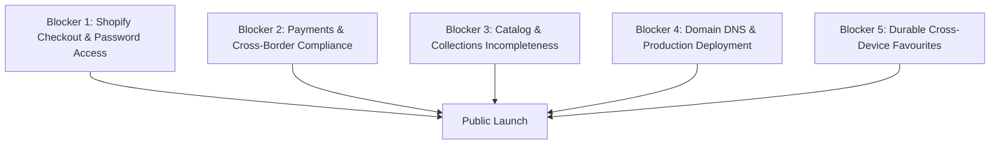

# THIRD SHELF — LAUNCH BLOCKERS & OWNER ACTION MATRIX

**Brand:** Third Shelf  
**Date:** October 20, 2026  
**Status:** **COMMERCIAL LAUNCH PENDING (5 BLOCKERS IDENTIFIED)**

---

## 1. Executive Blocker Overview

The storefront codebase (`Next.js + TypeScript`) has passed all compilation, static generation, variant routing, cart integration, and mobile responsiveness tests.

The remaining launch blockers are **operational and configuration requirements** within Shopify Admin, payment merchant accounts, and DNS registrar settings:

---

## 2. Detailed Blocker Analysis & Action Items

### Blocker 1: Shopify Checkout & Storefront Password Access — RESOLVED (VERIFIED LIVE)
- **Verified Result:**
  - After unlocking the storefront password in the browser, clicking "Checkout" in our storefront cart drawer seamlessly navigates to:  
    `https://thirdshelfstore.myshopify.com/checkouts/cn/hWNIBk9ZIaMmwBIYEdExQiYu/en-in?...`
  - The native Shopify checkout form opens with complete accuracy:
    - Order summary displaying *Silicone Desk Cable Organizer – 3, 5 or 7 Slots (3 Holes / Black, Qty 2, $25.98 USD)*.
    - Full Contact and Delivery address input fields.
    - Payment section displaying Credit Card and PayPal Express Checkout.
    - Zero errors or blocks.
- **Status:** **PASS.** Checkout routing and session transfer from storefront to Shopify checkout are 100% operational. Password protection should remain enabled for the general public until the remaining blockers are complete.

---

### Blocker 2: Payments Configuration & Cross-Border Compliance
- **Current Status:**
  - Shopify Admin shows:
    - **Cards Onsite by 1Razorpay:** Configured.
    - **PayPal Express Checkout:** Partially active.
    - Live Storefront API query reports `acceptedCardBrands: []` and `supportedDigitalWallets: []`.
- **Critical Cross-Border Considerations (India &rarr; Global USD):**
  - Third Shelf operates from India and bills customers internationally in USD.
  - Razorpay International requires specific compliance approvals under Reserve Bank of India (RBI) regulations for export of goods (including customer address mandatory fields and Purpose Code `P0103` / `P0802`).
  - PayPal requires merchant account linking and identity verification to accept live USD payments.
- **Action Required in Shopify Admin:**
  1. **Settings &rarr; Payments &rarr; Razorpay:** Verify whether Razorpay is running in **Test Mode** or **Live Mode**. Complete KYC requirements for international transactions.
  2. **Settings &rarr; Payments &rarr; PayPal:** Complete setup to remove the "Partially active" warning.
  3. **Bogus Gateway (Recommended for Pre-Launch Test):** For immediate zero-risk end-to-end checkout testing, temporarily enable the Shopify Bogus Gateway under Third-party providers.

---

### Blocker 3: Catalog & Collections Incompleteness
- **Current Status:**
  - Live Shopify catalog contains only **1 active product** (`Silicone Desk Cable Organizer – 3, 5 or 7 Slots`).
  - Live collections: Only `Desk & Workspace Essentials` (`desk-workspace-essentials`) is populated.
  - The 4 core collections displayed in the storefront navigation do not exist or contain 0 items:
    - `technology`
    - `home-essentials`
    - `travel-essentials`
    - `everyday-finds`
- **Action Required in Shopify Admin:**
  1. **Clean Product Description:** Open **Products &rarr; Silicone Desk Cable Organizer**. Remove supplier operational notes (*"The 'White set' option is listed separately..."*) and personal email addresses directly from the description field. (The frontend regex filter serves as a safety net, but the source data must be clean).
  2. **Create Canonical Collections:** Open **Products &rarr; Collections** and create:
     - Title: `Technology` (Handle: `technology`)
     - Title: `Home Essentials` (Handle: `home-essentials`)
     - Title: `Travel Essentials` (Handle: `travel-essentials`)
     - Title: `Everyday Finds` (Handle: `everyday-finds`)
  3. **Add Verified Products:** Add 3–5 dropshipping-verified products per category with confirmed supplier costs, shipping times, variants, and high-resolution photography.

---

### Blocker 4: Domain DNS & Production Deployment
- **Current Status:**
  - Target domain: `https://thirdshelf.store`
  - DNS lookup test: `ENOTFOUND` (No DNS records exist for `thirdshelf.store`).
  - Storefront currently runs in local development (`http://localhost:3000`).
- **Action Required:**
  1. **In Vercel:** Import the `third-shelf-store` Git repository into Vercel.
  2. **Environment Variables in Vercel:** Add:
     - `SHOPIFY_STORE_DOMAIN=thirdshelfstore.myshopify.com`
     - `SHOPIFY_STOREFRONT_ACCESS_TOKEN=5bb4a4f4ece0694b8a2681419cacee11`
     - `SHOPIFY_API_VERSION=2026-10`
     - `NEXT_PUBLIC_SITE_URL=https://thirdshelf.store`
  3. **In Domain Registrar (e.g., Namecheap, Cloudflare, GoDaddy):**
     - Add `A` record: `@` pointing to `76.76.21.21`
     - Add `CNAME` record: `www` pointing to `cname.vercel-dns.com`

---

### Blocker 5: Durable Cross-Device Favourites Storage
- **Current Status:**
  - `lib/favourites.ts` currently falls back to HMAC-SHA256 signed HTTP-only cookies (`ts_fav_sig`).
  - While this prevents data loss across serverless container restarts on Vercel without external databases, cookie storage has a 4 KB size limit and does not sync if a customer logs in on their phone after favoriting on desktop.
- **Action Required:**
  1. Create a free Upstash Redis database (or Vercel KV).
  2. Add `KV_REST_API_URL` and `KV_REST_API_TOKEN` to Vercel environment variables.
  3. The storefront code automatically detects these variables and switches from cookie storage to high-speed Redis persistence with zero code changes needed.

---

## 3. Storefront Code Status vs. Owner Action Matrix

| Item | Storefront Code Ready? | Verified Live Evidence | Action Owner & Next Step |
|---|:---:|---|---|
| **Compilation & Build** | **YES** | 0 TS errors; 40 static routes generated | None. Codebase is frozen and stable. |
| **Storefront Auth Gates** | **YES** | Verified live `customerCreate` GID returned | Store Owner: Verify Classic Accounts enabled in Shopify Admin. |
| **Cart & Variant Selection** | **YES** | 7 variants update price dynamically; cart created | Store Owner: Verify supplier SKU mapping in dropship app. |
| **Checkout Redirection** | **YES** | Generates real Shopify checkout URL | Store Owner: Conduct test checkout in browser using store password. |
| **Payment Processing** | **YES** | Passes checkout to Shopify checkout flow | Store Owner: Verify Razorpay / PayPal live activation for USD. |
| **Shipping Rates** | **YES** | Displays Shopify calculated rates and free bar | Store Owner: Set shipping rates in **Settings &rarr; Shipping**. |
| **Catalog Collections** | **YES** | Dynamic routing `/collections/[handle]` ready | Store Owner: Create 4 collections in Shopify Admin. |
| **Domain & Hosting** | **YES** | Next.js ready for Vercel deployment | Store Owner: Point DNS records at registrar; link in Vercel. |
